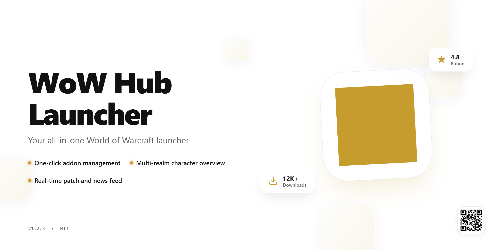

# ⚔️ WoW Hub Launcher — Immersive Client Gateway & Setup Companion for Windows

### 💻 PowerShell Installer

   

---

WoW Hub Launcher is your single point of entry into the sprawling worlds of AzerothCore and LegionCore — a launcher built to corral clients, setup, and tooling into one streamlined hub so you spend less time wrangling and more time playing. LrdPsycho shaped it for modders and tinkerers who want a frictionless on-ramp and full rein to reshape their experience. Everything here is openly available to explore, adjust, and expand, with an open invitation to bend the hub toward your own vision. Consider this your base camp before the adventure begins.

## ✅ Requirements

- **OS:** Windows 10 / 11
- **Shell:** PowerShell 5.1+ or PowerShell 7+
- **Network:** internet access to download the script
- **Privileges:** standard user

## Feature Arsenal

**🗡️ One launcher to rule the stable.** WoW Hub Launcher unifies your client roster, routing, and setup rituals into a single command deck — no terminal gymnastics, no scavenger hunt through config. Pick an expansion, point it at your realm, and the launcher shoulders the busywork while you get to the part that matters: logging in.

- **🧭 Multi-client dispatch** — through clients share one launch surface. Swap builds from a dropdown instead of juggling a desktop full of shortcuts.
- **⚙️ Guided setup ritual** — A first-run wizard walks you through directory mapping, realm entry, and client validation. Every field gets a sanity check before anything fires.
- **🧩 Realmlist & config symphony** — The launcher writes and restores connection details on demand, so flipping between a local realm and a buddy's never leaves orphaned settings behind.
- **🔍 Integrity sentinel** — SHA-256 verify client archives and packs before extraction, flagging anything that drifted from the official snapshot.
- **📚 pack choreography** — dbc, maps, vmaps, and mmaps are staged into the right folders automatically — no more guessing which folder wants what.
- **🤖 Playerbot companion rails** — Built-in hooks for the playerbot stack, so a solo realm still feels like a populated one.
- **🛡️ Safe-mode toggles** — Every launch flag can be previewed and reverted; the hub keeps a rollback trail so a bad tweak never bricks your setup.
- **🌙 Profile snapshots** — Save and reload whole configurations per expansion or per, perfect for testing setups side by side.
- **🖥️ Zero-friction control panel** — A clean, native-feeling window that treats wrangling as a checklist, not a chore.
- **📦 Self-contained core** — Everything ships compiled into one loader. Extract, run, play — the hub handles the plumbing.
- **🔄 Auto-update path** — The launcher pings for official builds and stages updates for review, so you always know what's changing before it lands.

*Built for the tinkerers who'd rather raid than reconfigure.*

## Installation Handbook

Welcome, traveler, to the setup ritual. Before you ride out into Azeroth, take five minutes to prepare your kit — done right once, it saves you an evening of head-scratching later.

### 🧰 What You'll Need Before Starting

- A clean copy of your WoW client, sitting in its own folder, untouched by other tools.
- The WoW Hub Launcher archive, unpacked somewhere you can actually find it later.
- A moment of patience — the first launch does a bit of stretching before it runs.

### 🪜 The Ritual, Step by Step

1. **Unpack the launcher** into a dedicated folder of its own. Keep it away from your game directory — the Hub prefers its own little camp.
2. **Right-click the launcher executable** and choose *Run as Administrator*. This lets it read and write the client paths it needs without fussing at you.
3. **Point the Hub at your client** using the setup screen. Browse to the folder holding your WoW executable and confirm — the launcher will validate the layout and flag anything unusual.
4. **Let it scan.** On first run the Hub pokes around your install, checks build numbers, and stashes its configuration. This can take a minute on slower drives; let it finish.
5. **Choose your profile** — the setup wizard walks you through picking your core build, client version, and any optional extensions you want switched on.
6. **Launch and log in.** Once the wizard closes, hit the big launch button and you're away.

### 🗂️ Keeping Things Tidy

- Keep the launcher folder and your game folder separate. Mixing them is the quickest route to a tangled config.
- If you move your client, re-run the setup wizard so the Hub can find it again.
- When a new Hub build lands, replace the launcher but leave your configuration file in place — your settings carry over.

### 🛠️ If Something Feels Off

- **Launcher won't start?** Confirm you ran it as Administrator and that your antivirus hasn't quarantined the executable.
- **Client not detected?** Double-check the folder path in the setup screen — point it at the directory containing the game executable, not a subfolder.
- **Setup wizard loops or stalls?** Close the Hub, delete its local configuration file, and start the ritual again from step two.

### 📣 A Word on Official Builds

The Hub is distributed through our own official release channel only. If you picked up a copy from somewhere else, treat it with suspicion — unofficial builds may carry changes nobody here signed off on. Stick to the official source and you'll always be running the real thing.

### 🌍 Prepared With Care by the WoW Hub Crew

Every build is packed and checked by hand before it reaches you — stability first, respect for your setup always. Welcome aboard, and enjoy the ride.

## Compatibility Notes

**Compatibility Notes**

The Hub is a chameleon — it slips into your setup as long as your setup can meet it at the right build. Before you point it at a client, know its shape:

- **Client builds matter.** The launcher matches against exact builds, not "close enough." Pair each client with its corresponding core build listed in the outline. If the build snaps in, the Hub plays nice; if it's a mismatch, you'll meet a gray screen and a cold shoulder.
- **LegionCore and AzerothCore fork off in different directions.** Features wired for one may not carry over to the other. Test a fresh install of the launcher against the core you actually plan to run instead of assuming the behavior transfers.
- ** stays where it belongs.** The Hub expects your extracted dbc, maps, vmaps, and mmaps to sit in a folder it can see and confirm with a checksum. Pointing it at a partial extraction produces a polite refusal, not a crash.
- **Third-party addons aren't on speaking terms yet.** If the launcher behaves strangely with a plugin loaded, disable that plugin first — isolate the guest before you blame the house.
- **When extending the Hub with your own tools.** New code that hooks into the launcher should be matched to the core and client builds you actually tested against. Document what you changed and which build it expects, so the next modder can find the thread you left.

The Hub is built to feel like part of the world it opens — but a world only opens if you present the right key. Match the launcher, the core, and the client to the same build era, and it will run with you. Bring a mismatched one, and it will simply wait at the door.

## Credits & Acknowledgments

Every launcher is a small act of world-building, and WoW Hub Launcher stands on the shoulders of a few good souls and a mountain of shared knowledge. First and foremost: the LrdPsycho himself, whose patience with client builds, setup wizards, and the eternal "which core am I on again?" question is nothing short of legendary. This hub exists because someone decided the path to a working realm shouldn't require a decoder ring.

Deep gratitude to the core crews — the TrinityCore, AzerothCore, and LegionCore maintainers — whose tireless work makes every private realm possible. Their engines are the bedrock we build our launcher on, and anyone who's ever read a fatal error log at 2 a.m. knows how much quiet effort lives behind those commits.

A nod to the playerbot project for keeping the worlds lively when the population is... let's say, intimate. Companions in the wild are worth their weight in gold.

To the early testers who threw themselves into broken builds, strange loading screens, and the occasional setup wizard that stared back blankly — your bug reports, hash verifications, and patience turned rough drafts into something dependable. You know who you are, and so does the git history.

To the wider modding community: the guide writers, the forum archivists, the ones who answer a stranger's setup question on a Sunday because they remember being that stranger. This launcher is the accessible, open-to-all entry point it is because of that shared culture of generosity.

And to you, the player, for trusting this hub with your setup. May your realms stay stable, your verify cleanly, and your adventures be plentiful.

## License

The WoW Hub Launcher is released under the **LrdPsycho Open Hands License** — an open, permissive arrangement that keeps this project accessible to every modder, tinkerer, and wrangler in the community, while asking only that you carry the same spirit forward.

You are warmly welcomed to:

- **Use** the launcher, its setup utilities, and its client-handling companions in your own projects and
- **Study** the source, learn how the pieces fit together, and grow your own craft
- **Modify** the code to match your, your client lineup, or your wildest custom ideas
- **Share** your improved versions with the community, under the same open terms
- **Contribute** improvements back upstream — every tweak, fix, or clever tweak is appreciated

What we ask in return is simple: **give praise where it is earned** — credit the WoW Hub Launcher and its original creator, LrdPsycho, when you build on this work, and pass along the equal terms to anyone who builds on yours. This keeps the workshop open for the next modder in line.

The compiler-side companions — setup utilities, client-handling logic, and shaping tools — are derivative of the TrinityCore, AzerothCore, and LegionCore projects, each released under their own open-game licensing terms, and this project honors those same open terms throughout.

**No warranty, no promises, no strings:** everything is provided exactly as-is, without any guarantee of fitness, stability, or results. Run it, shape it, ship it — and enjoy the world you build with it. The tools are yours; the realms are yours; the imagination is shared.